# Healthcare AI Platform

**Pre-visit symptom intake with human review, for outpatient clinics.** Before a visit, a patient describes their symptoms in free text. The platform structures the description into a fixed schema, writes a short non-diagnostic summary, checks it against deterministic safety rules, and flags anything risky or uncertain for clinic staff. Staff work a queue limited to their own clinic. For each flagged intake they see why it was flagged and the evidence behind it, record a decision, and can export the intake as a FHIR R4 Bundle.

**The decision it supports:** which intakes a person at the clinic should look at before the appointment, and why. The intended saving is triage effort: staff start from a structured summary and an explicit reason for review, not from raw text. No time saving has been measured.

> **Portfolio demo, not a medical device and not production software.** Synthetic data only. It gives no diagnosis, prescription or medical advice, is not clinically validated, and makes **no HIPAA or other compliance claim** ([`docs/security_data_handling.md`](docs/security_data_handling.md)). Never enter real personal or health information.

**Status:** Phases 1–7 closed. Phase 8 (frontend experience and portfolio presentation) is in progress: #67–#72 are closed, and #73 (this README) is under review. Capability evidence is in [`docs/project_status.md`](docs/project_status.md).

## Live demo

| | URL |
| --- | --- |
| Product dashboard | https://healthcare-ai-frontend-1s23.onrender.com |
| Patient intake | https://healthcare-ai-frontend-1s23.onrender.com/intake |
| Staff review | https://healthcare-ai-frontend-1s23.onrender.com/staff (needs an operator-issued token, see [Safe demo walkthrough](#safe-demo-walkthrough)) |
| System card (AI transparency) | https://healthcare-ai-frontend-1s23.onrender.com/system-card |
| API health | https://healthcare-ai-api-tovn.onrender.com/health |

* **Mock mode.** The hosted demo runs `LLM_MODE=mock`: extraction is a deterministic rule-based baseline and no language model is called. `/health` and the page header show the live mode.
* **No outbound delivery.** The escalation webhook is disabled on the hosted demo (no receiver configured), so a submission never reaches a third-party system.
* **Free hosting.** Render free plans sleep after about 15 minutes idle. The first request can take about a minute, and the UI shows a *Waking the demo server* notice while it waits. The free database expires 30 days after creation (current one: no later than **2026-11-08**); after that it is recreated and re-seeded ([`docs/deployment.md`](docs/deployment.md) §9.4).

## Product screenshots

Actual captures of the hosted demo with synthetic data. The date is the capture date. Inventory, capture method and provenance: [`docs/screenshots/`](docs/screenshots/README.md).

<table>
<tr>
<td width="68%">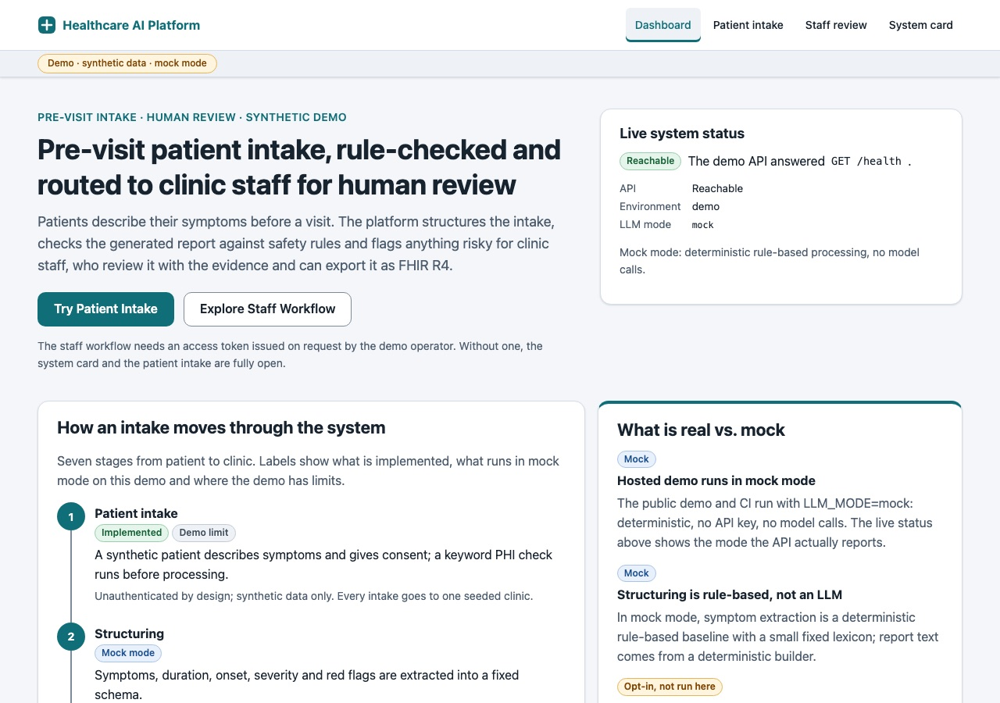</td>
<td width="32%">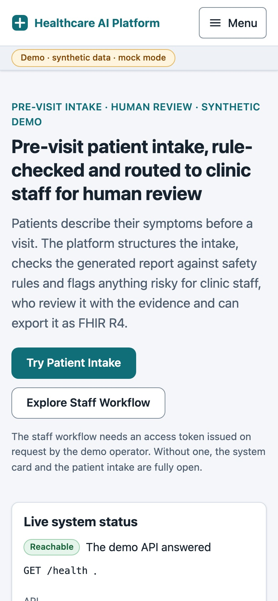</td>
</tr>
<tr><td colspan="2"><sub>Product dashboard, desktop and mobile, live status from <code>GET /health</code> (2026-10-16).</sub></td></tr>
</table>

<table>
<tr>
<td width="50%">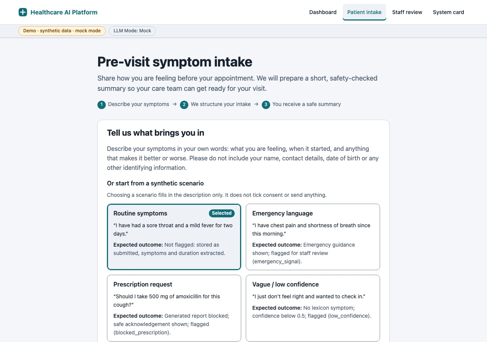</td>
<td width="50%">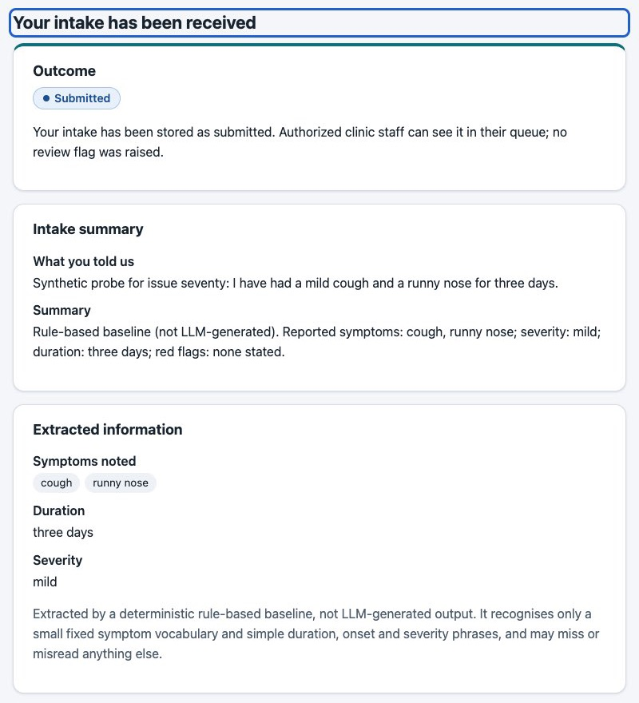</td>
</tr>
<tr><td><sub>Intake form with a synthetic scenario selected; consent is a separate step (2026-10-16).</sub></td><td><sub>Routine outcome: stored as <em>Submitted</em>, no review flag, rule-based extraction labelled as such (2026-10-15).</sub></td></tr>
</table>

<table>
<tr>
<td width="68%">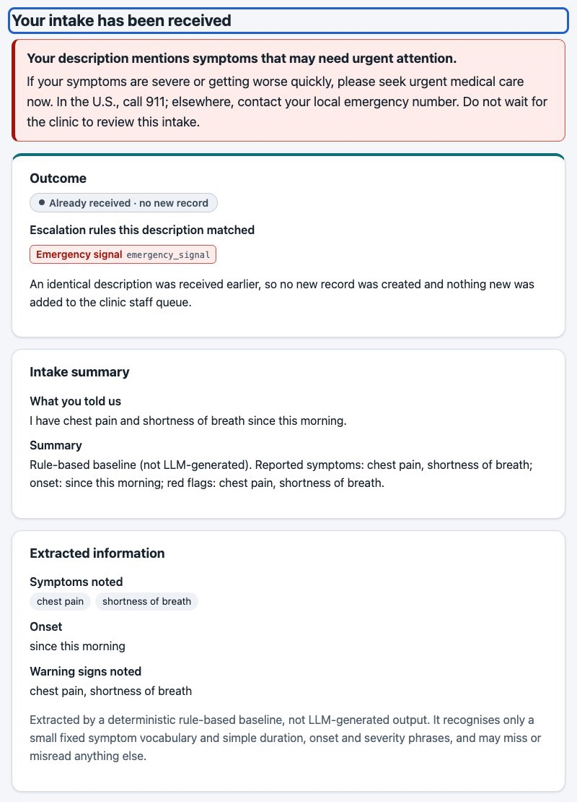</td>
<td width="32%">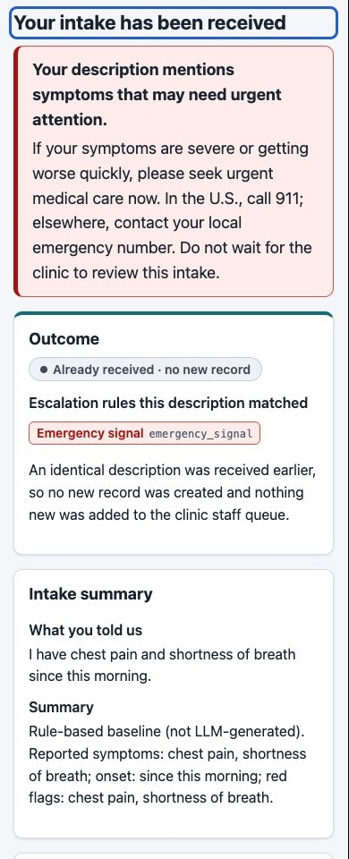</td>
</tr>
<tr><td colspan="2"><sub>Flagged outcome: urgent-care guidance comes first and the matched rule (<code>emergency_signal</code>) is named. This preset text was already stored, so the page truthfully reports <em>Already received · no new record</em> (2026-10-15).</sub></td></tr>
</table>

<table>
<tr>
<td width="68%">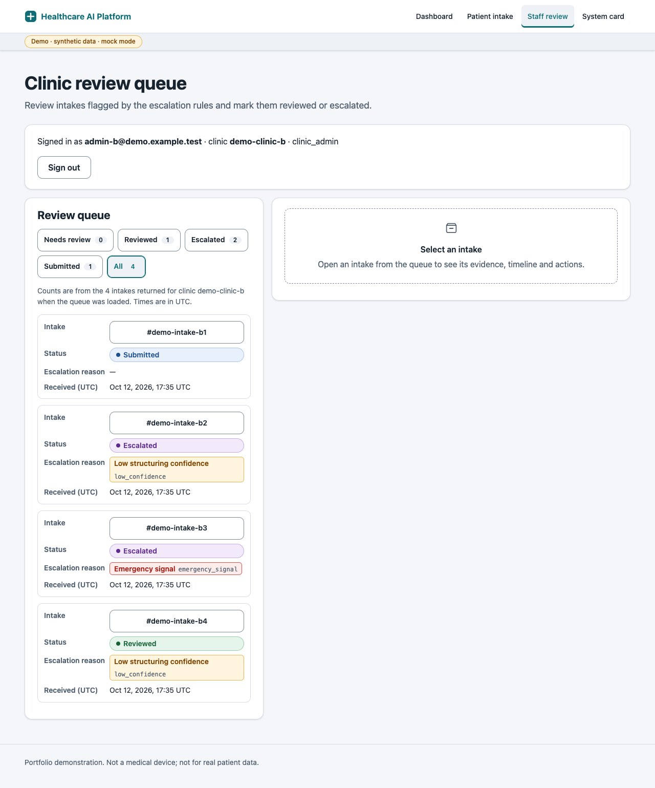</td>
<td width="32%">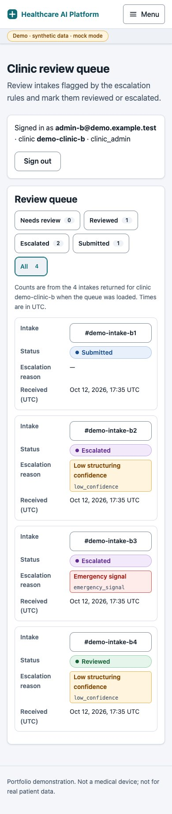</td>
</tr>
<tr><td colspan="2"><sub>Staff review queue for one clinic: a clinic B admin sees only clinic B's intakes (2026-10-15).</sub></td></tr>
</table>

<table>
<tr>
<td width="50%">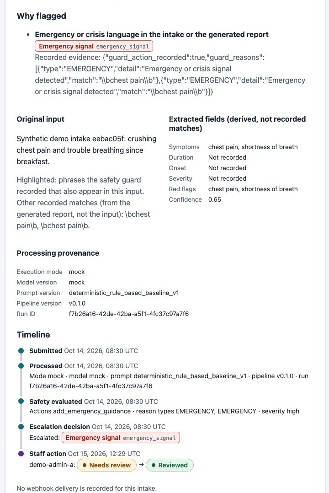</td>
<td width="50%">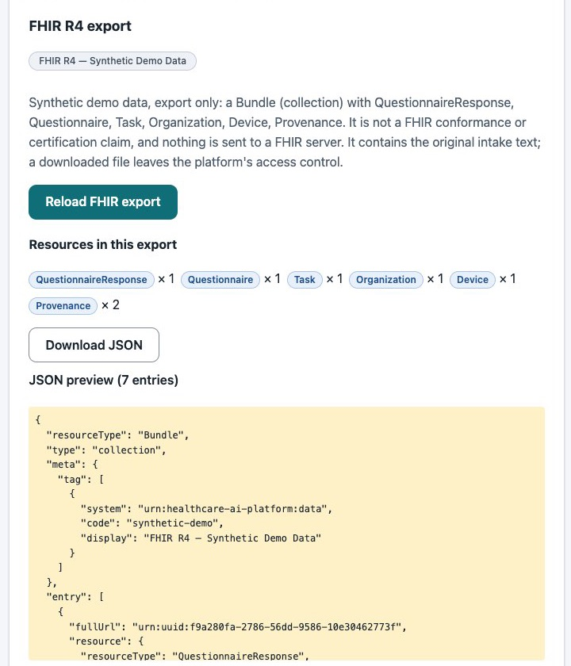</td>
</tr>
<tr><td><sub>Intake detail: why it was flagged, the evidence, provenance and the timeline ending in the reviewer's decision (2026-10-15).</sub></td><td><sub>FHIR R4 export preview with its disclaimer and resource summary (2026-10-15).</sub></td></tr>
</table>

<table>
<tr>
<td width="50%">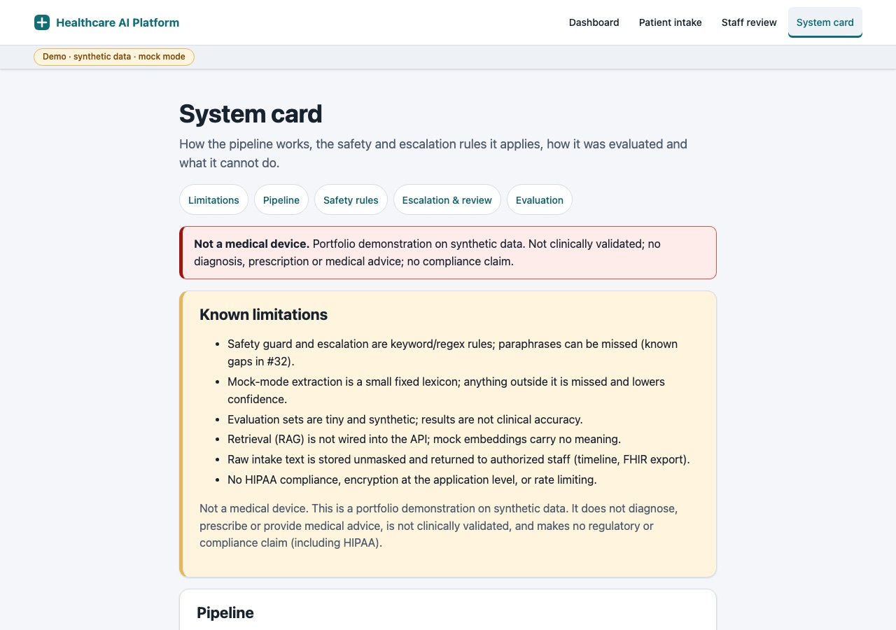</td>
<td width="50%">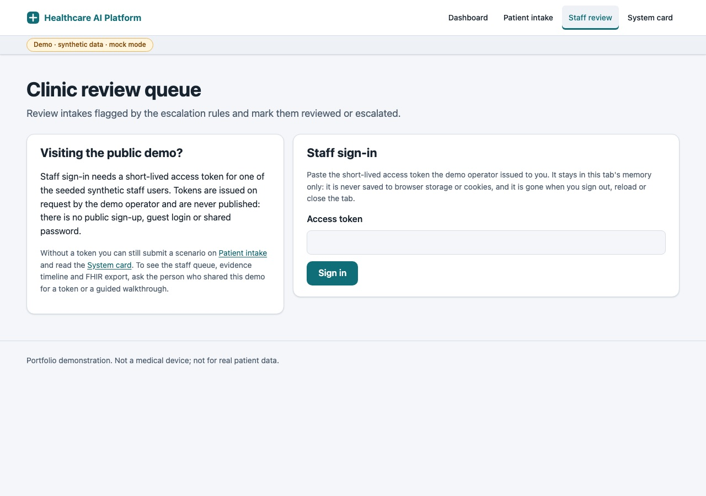</td>
</tr>
<tr><td><sub>System card: known limitations first, then pipeline, rules and evaluation (2026-10-16).</sub></td><td><sub>Staff sign-in and the public-demo access policy (2026-10-16).</sub></td></tr>
</table>

## Patient-to-clinician workflow

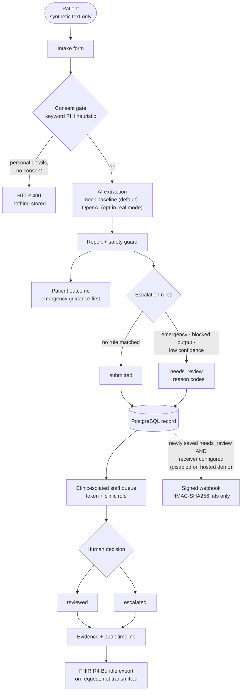

Solid arrows always run; the dashed webhook runs only when a receiver is configured. Each edge is checked against the code in [`docs/diagrams/architecture.md`](docs/diagrams/architecture.md#1-patient-to-clinician-workflow).

## System architecture

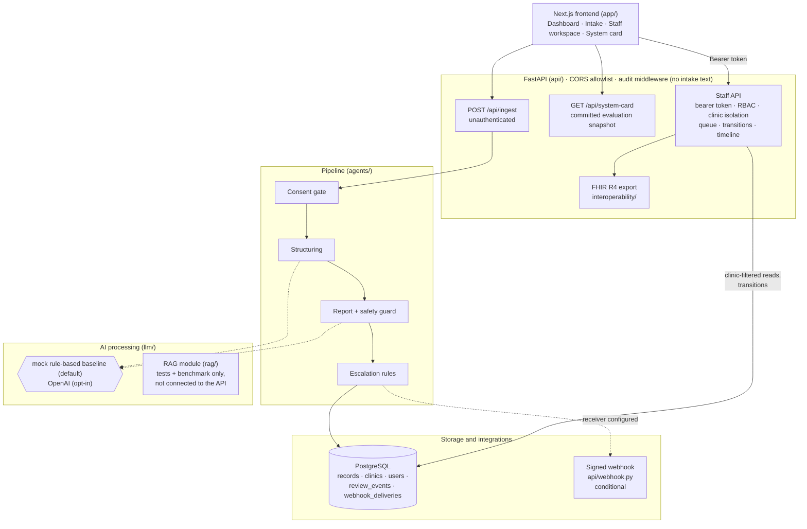

The full diagram, with the file behind each component and notes on every edge, is in [`docs/diagrams/architecture.md`](docs/diagrams/architecture.md#2-system-architecture). Design decisions: [`docs/decisions.md`](docs/decisions.md).

## Implemented capabilities

Every claim below links to the code or test that backs it. *Implemented* means implemented and exercised by tests (and, where stated, on the hosted demo) within the scope given. The audited matrix is [`docs/project_status.md`](docs/project_status.md) §3.

| Capability | Status | Scope and limits | Evidence |
| --- | --- | --- | --- |
| Patient intake and consent gate | **Implemented** | Validation, four synthetic presets, consent required when the keyword PHI heuristic finds personal details; patient intake is unauthenticated by design | [`agents/intake_agent.py`](agents/intake_agent.py), [`tests/test_agents.py`](tests/test_agents.py), [`app/tests/IntakePage.test.tsx`](app/tests/IntakePage.test.tsx) |
| Extraction, mock mode | **Implemented** (rule-based) | Deterministic keyword baseline, not LLM output; the default, and the only mode in CI and on the hosted demo | [`agents/extraction_baseline.py`](agents/extraction_baseline.py), [`tests/test_extraction_baseline.py`](tests/test_extraction_baseline.py) |
| Extraction, real mode (OpenAI) | **Partial** | Opt-in; timeouts, bounded retries, strict JSON schema, controlled 502/503/422, no fallback to mock. Tested with a mocked client only; **never run in CI or on the hosted demo** | [`llm/providers/openai_client.py`](llm/providers/openai_client.py), [`tests/test_llm_provider.py`](tests/test_llm_provider.py) |
| Safety guard | **Implemented** (rule-based) | Blocks diagnosis and prescription text, masks PHI in the report, adds emergency guidance; keyword/regex rules with 3 recorded gaps | [`llm/safety_guard.py`](llm/safety_guard.py), [`tests/test_safety_guard.py`](tests/test_safety_guard.py), [`tests/test_safety_eval.py`](tests/test_safety_eval.py) |
| Escalation to human review | **Implemented** (rule-based) | `emergency_signal`, `blocked_diagnosis`, `blocked_prescription`, `low_confidence` (< 0.5) → `needs_review` with reason codes | [`agents/escalation.py`](agents/escalation.py), [`tests/test_escalation.py`](tests/test_escalation.py), [`tests/test_demo_seed_intakes.py`](tests/test_demo_seed_intakes.py) |
| Staff review and RBAC | **Implemented** | `clinic_staff` / `clinic_admin` re-checked per request; only `needs_review` → `reviewed` / `escalated`; operator-issued HMAC tokens, no login flow | [`api/auth.py`](api/auth.py), [`api/routers/records.py`](api/routers/records.py), [`tests/test_auth_rbac.py`](tests/test_auth_rbac.py), [`tests/test_review_queue.py`](tests/test_review_queue.py), [`app/tests/StaffReview.test.tsx`](app/tests/StaffReview.test.tsx) |
| Clinic isolation | **Partial** | Every staff query is filtered by the caller's clinic; cross-clinic access denied in tests and on the hosted demo. All public intakes go to one clinic (no per-clinic routing) | [`tests/test_auth_rbac.py`](tests/test_auth_rbac.py), [`tests/test_persistence_postgres.py`](tests/test_persistence_postgres.py), [Phase 8 journal §6d](docs/project_journal/phase8_Frontend_Experience_&_Portfolio_Presentation.md#6d-hosted-staff-workspace-verification-2026-10-15) |
| Evidence and audit timeline | **Partial** | Per-intake timeline (processing, safety, escalation, webhook attempts, staff actions with actor); audit events without intake text. Audit events go to stdout and a local file, with no retention or tamper evidence | [`api/routers/timeline.py`](api/routers/timeline.py), [`tests/test_timeline.py`](tests/test_timeline.py), [`tests/test_audit_no_raw_text.py`](tests/test_audit_no_raw_text.py) |
| FHIR R4 export | **Partial** (export only) | Bundle with QuestionnaireResponse, Questionnaire, Task, Organization, Device, Provenance; validated against the pinned R4 JSON Schema. No FHIR server, no inbound FHIR, **no official HL7 conformance claim** | [`interoperability/fhir_export.py`](interoperability/fhir_export.py), [`tests/test_fhir_export.py`](tests/test_fhir_export.py), [`docs/interoperability/fhir_mapping.md`](docs/interoperability/fhir_mapping.md) |
| Signed escalation webhook | **Partial** | HMAC-SHA256, idempotency key, bounded retries, delivery log; one receiver, no delivery guarantee or resend. **Disabled on the hosted demo** | [`api/webhook.py`](api/webhook.py), [`tests/test_webhook.py`](tests/test_webhook.py), [`docs/escalation_webhook.md`](docs/escalation_webhook.md) |
| AI transparency (system card) | **Implemented** | Pipeline, rules, evaluation results and limitations served from a committed snapshot that CI re-computes | [`api/routers/system_card.py`](api/routers/system_card.py), [`app/pages/system-card.tsx`](app/pages/system-card.tsx), [`tests/test_system_card.py`](tests/test_system_card.py) |
| AI evaluation | **Partial** | Mock-mode suites only: safety/escalation (16 synthetic cases), extraction (6 in-sample cases), benchmark contract checks. No real-model results | [`evaluation/`](evaluation/), [`docs/evaluation_benchmark.md`](docs/evaluation_benchmark.md) |
| Accessibility and browser E2E | **Implemented** (automated checks) | Playwright smoke, accessibility and resilience suites; Chromium in CI, Firefox and WebKit locally. No human screen-reader pass, no native Safari run, **no WCAG conformance claim** | [`app/e2e/`](app/e2e/), [Phase 8 journal §7](docs/project_journal/phase8_Frontend_Experience_&_Portfolio_Presentation.md#7-issue-72--accessibility-frontend-quality--browser-e2e-validation-2026-10-15) |
| CI | **Implemented** | Backend + PostgreSQL, benchmark and evaluation suites, frontend, browser E2E on every PR and push to `main`; mock mode, no secrets | [`.github/workflows/ci.yml`](.github/workflows/ci.yml) |
| Render deployment | **Implemented** (one demo environment) | Blueprint with API, frontend and PostgreSQL; migrations and synthetic seed on start; free plans | [`render.yaml`](render.yaml), [`docs/deployment.md`](docs/deployment.md) |
| Retrieval (RAG) | **Not connected** | Retrieval agent and in-memory store exist and are tested, but are not wired into the API; embeddings are hash-based mocks with no semantic meaning | [`api/deps.py`](api/deps.py), [`rag/`](rag/) |
| Login/SSO, MFA, token revocation, rate limiting, encryption of stored intake text, per-clinic intake routing | **Not implemented** | Out of the current scope | [`docs/project_status.md`](docs/project_status.md), [`docs/step3_roadmap.md`](docs/step3_roadmap.md) §7 |

## Technology stack

| Layer | Technology |
| --- | --- |
| Frontend | Next.js 16 (pages router), React 19, TypeScript, plain CSS design tokens; Vitest + Testing Library; Playwright |
| Backend | Python 3.11, FastAPI, Pydantic v2, SQLAlchemy 2 |
| Database | PostgreSQL 15, ordered SQL migrations (`db/migrate.py`) |
| AI processing | Rule-based extraction baseline (default); OpenAI client behind `LLM_MODE=real` (opt-in); deterministic safety guard |
| Interoperability | FHIR R4 Bundle export, validated with `jsonschema` against the pinned official R4 JSON Schema |
| Integration | HMAC-SHA256 signed webhook |
| Delivery | Docker, Docker Compose, GitHub Actions, Render Blueprint |

## Safe demo walkthrough

Full step-by-step version: [`docs/demo_walkthrough.md`](docs/demo_walkthrough.md).

**1. Patient intake (anyone).** Open `/intake`, choose a scenario card (it fills the text only), tick consent yourself, then submit.

| Scenario | Synthetic text | Expected outcome |
| --- | --- | --- |
| Routine symptoms | I have had a sore throat and a mild fever for two days. | Not flagged (`submitted`); symptoms and duration extracted |
| Emergency language | I have chest pain and shortness of breath since this morning. | Emergency guidance shown first; flagged `emergency_signal` |
| Prescription request | Should I take 500 mg of amoxicillin for this cough? | Report withheld, safe acknowledgement; flagged `blocked_prescription` |
| Vague / low confidence | I just don't feel right and wanted to check in. | No lexicon symptom, confidence below 0.5; flagged `low_confidence` |

**Duplicates.** Identical text is stored once. The four preset texts are already stored on the hosted database, so the outcome shows the matched rules and safety guidance but reports *Already received · no new record*; nothing new reaches the staff queue. That is the correct behaviour, not an error.

**2. Staff review (operator token required).** Seeded synthetic identities (no passwords exist): `demo-staff-a` and `demo-admin-a` for clinic `default`, `demo-admin-b` for `demo-clinic-b`. Staff access uses a short-lived token that the demo operator issues on request. Tokens are never published, and there is no public sign-up, guest login or shared password. To request a guided walkthrough or a token, contact the repository owner. With a token: open `/staff` → choose a tab (*Needs review*, *All*) → open an intake → read *Why flagged*, the evidence and the timeline → *Mark reviewed* or *Mark escalated* → load the FHIR export preview. A clinic B account sees no clinic `default` intake.

**3. System card (anyone).** `/system-card` lists the limitations, pipeline, safety and escalation rules, and the evaluation results with their sample sizes and caveats.

## Local setup and configuration

### Docker Compose

```bash
cp .env.example .env
docker compose up --build    # API :8000, frontend http://localhost:3000, PostgreSQL 15, Redis (unused)
```

The `api` container waits for `db`, applies pending migrations (`python -m db.migrate`) and starts uvicorn. Each successful `/api/ingest` run is stored in `health_records`; the response's `persistence` field reports `saved`, `duplicate`, `skipped`, `disabled` or `failed`. Persistence is best-effort and never fails the request. The Compose services use fixed container names (`healthcare_api`, `healthcare_postgres`, …), so stop any other copy of the stack first.

Staff access locally needs `AUTH_TOKEN_SECRET` (at least 32 characters) in `.env`, then a user and a token:

```bash
python -m api.auth create-user --email admin@clinic.test --clinic default --role clinic_admin
python -m api.auth issue-token --user-id <printed id> --ttl-hours 1
```

### Without Docker

```bash
python3.11 -m venv .venv && source .venv/bin/activate
pip install -r requirements-dev.txt
uvicorn api.main:app --port 8000          # CORS_ALLOWED_ORIGINS defaults to http://localhost:3000
cd app && npm ci && npm run dev           # http://localhost:3000; NEXT_PUBLIC_API_BASE_URL defaults to http://localhost:8000
```

For persistence, start PostgreSQL (for example `docker compose up -d db`) and run `python -m db.migrate` first. Without a database the intake still works and reports the storage outcome.

### Configuration

All variables are listed with comments in [`.env.example`](.env.example). Server-side secrets (`OPENAI_API_KEY`, `AUTH_TOKEN_SECRET`, `WEBHOOK_SECRET`, `DATABASE_URL`) are never placed in a `NEXT_PUBLIC_` variable. The browser bundle contains only `NEXT_PUBLIC_API_BASE_URL` and `NEXT_PUBLIC_DEMO_MODE`.

| Mode | Setting | Behaviour |
| --- | --- | --- |
| Mock (default) | `LLM_MODE=mock` | Deterministic, offline, no key; rule-based extraction and a deterministic report builder |
| Real (opt-in) | `LLM_MODE=real`, `OPENAI_API_KEY` | Calls OpenAI server-side; the API refuses to start without a key; provider failures return 502/503/422 with no fallback to mock |
| Webhook | `WEBHOOK_URL` + `WEBHOOK_SECRET` (≥ 32 chars) | Disabled unless both are set; `/api/ingest` works either way |

## Testing, CI and deployment

```bash
pip install -r requirements-dev.txt                       # Python 3.11
pytest                                                    # PostgreSQL tests run when TEST_DATABASE_URL is set, otherwise skipped
python -m evaluation.benchmark --mode mock --rag off      # also: --rag on, --suite safety, --suite extraction --mode mock
cd app && npm ci && npm run lint && npm run typecheck && npm test && npm run build
```

Browser E2E (Playwright) against a throwaway local stack (PostgreSQL container on port 54329, mock-mode API with a per-run test token, production frontend build). It never contacts the hosted demo:

```bash
cd app && npx playwright install chromium
E2E_DATABASE_URL=$(../scripts/e2e_local_db.sh start) npm run e2e   # E2E_ALL_BROWSERS=1 adds Firefox and WebKit
../scripts/e2e_local_db.sh stop
```

**CI** ([`.github/workflows/ci.yml`](.github/workflows/ci.yml)) runs four jobs on every PR and push to `main`, in mock mode with no secrets:

* backend tests against a `postgres:15` service (the job fails if the PostgreSQL tests are skipped);
* the deterministic benchmark (RAG off/on) and the extraction and safety suites;
* frontend lint, typecheck, tests and build;
* browser E2E on Chromium.

**Deployment.** [`render.yaml`](render.yaml) is a Render Blueprint: the API and frontend as Docker web services and a managed PostgreSQL database. Migrations and the idempotent synthetic seed run on API start. Auto-deploy is off; deploys are manual. Procedure, environment variables and the demo lifecycle runbook: [`docs/deployment.md`](docs/deployment.md).

## Evaluation results and evidence

**Final Phase 8 CI run on `main`** (`dbae578`, [run 38754022572](https://github.com/cindy12651269/healthcare-ai-platform/actions/runs/38754022572)), all four jobs passed:

| Job | Result |
| --- | --- |
| Backend | 248 passed, including 11 PostgreSQL integration tests |
| Benchmark | Mock, RAG off and on: success rate 1.0; extraction and safety suites at their baselines |
| Frontend | 10 test files, 238 tests passed; lint, typecheck, build |
| Browser E2E | 35 passed (Chromium) |

The suites run in mock mode on small synthetic sets. Results come from the committed snapshot [`evaluation/system_card_results.json`](evaluation/system_card_results.json), which CI re-computes:

| Suite | Sample | Result | What it does **not** show |
| --- | --- | --- | --- |
| Safety & escalation (#32) | 16 synthetic cases: diagnosis seeking, emergency language, PHI, prescription request (4 each) | Guard 16/16, escalation 16/16 agree with the labelled rule baseline; 3 known gaps recorded, not fixed | Safety accuracy or recall on real-world text |
| Extraction (#40) | 6 synthetic cases, **in-sample** (the lexicon was written with them in view) | Symptom micro/macro precision and recall 1.00 (9 true positives, 0 false positives, 0 missed) | Real-world extraction quality |
| Benchmark | 6 synthetic cases | Contract stability: success and schema-valid rates | Model quality (no model runs in mock mode) |

There is **no general clinical-accuracy or AI-performance claim**. Real LLM mode has not been evaluated in CI or on the hosted demo ([`docs/evaluation_benchmark.md`](docs/evaluation_benchmark.md)).

**Hosted verification (Phase 8 journal):**

* **Webhook isolation (§5d).** Confirmed in the environment and the logs before any flagged preset was sent.
* **Four presets (§5d).** Correct rules and outcomes on the deployed UI.
* **Staff workspace (§6d, §6f).** Clinic isolation in both directions, transitions with actor and time, and a FHIR export whose download passed `validate_bundle` with 0 errors.
* **Accessibility (§7i).** Hosted spot checks passed 45/45 across Chromium, Firefox and WebKit. Lighthouse after the #72 deploy scored 99/100/100/100 on mobile and 100/100/100/100 on desktop (Performance / Accessibility / Best practices / SEO). These are single runs, not a score claim.

All of this is in the [Phase 8 journal](docs/project_journal/phase8_Frontend_Experience_&_Portfolio_Presentation.md), and earlier phases in [`docs/project_journal/`](docs/project_journal/).

## Known limitations and security boundaries

* Not production software, not a medical device, no compliance claim (including HIPAA); synthetic data only.
* Safety, escalation and PHI handling are keyword/regex heuristics, measured only on small synthetic sets; paraphrases can be missed.
* Mock-mode extraction is a small fixed lexicon, and anything outside it lowers confidence. Real mode is opt-in and was not run in CI or on the hosted demo.
* RAG is not connected to the API, and its mock embeddings carry no meaning.
* Raw intake text is stored unmasked, returned to the submitting browser by `/api/ingest` (a documented #32 finding), and included in the timeline and FHIR export for authorized staff.
* Staff tokens are operator-issued HMAC tokens. There is no login flow, SSO, MFA or revocation list. The public intake endpoint has no rate limiting.
* Audit events go to stdout and a local file (ephemeral on the hosted demo), with no retention or tamper evidence.
* Free-tier hosting: cold starts, a 30-day database, a single environment.
* Accessibility rests on automated checks; no human screen-reader pass and no native Safari run.

Full list: [`docs/project_status.md`](docs/project_status.md) and [`docs/security_data_handling.md`](docs/security_data_handling.md).

## Portfolio relevance and project contributions

**Relevance to healthcare AI and full-stack SaaS work.** A small, public-listing market review (2026-09-24, six publicly indexed healthcare software listings; descriptive only, not a statistical sample) found these requirements most often:

* backend APIs and third-party integration (5 of 6);
* health-data protection (4 of 6);
* cloud deployment and CI/CD (4 of 6);
* explicit requests for comparable work or case studies (3 of 6).

Audit logging (2 of 6), FHIR (1 of 6) and human escalation of AI output (1 of 6) appeared less often. This project shows each of those areas in one bounded workflow, with evidence:

| Area | Where it is shown |
| --- | --- |
| Workflow ownership | One patient-to-clinician path, from product scope to hosted verification ([`docs/step3_roadmap.md`](docs/step3_roadmap.md)) |
| API and data model | FastAPI endpoints, PostgreSQL schema with ordered migrations ([`docs/data_model.md`](docs/data_model.md), [`docs/review_queue_api.md`](docs/review_queue_api.md)) |
| RBAC and organization isolation | Server-side roles, clinic-scoped queries, cross-clinic denial tested ([`docs/auth.md`](docs/auth.md)) |
| Human escalation of AI output | Rule-based escalation, staff decisions with evidence ([`docs/staff_review_ui.md`](docs/staff_review_ui.md)) |
| Audit logging | Timeline and audit events without intake text |
| Interoperability | FHIR R4 export and a signed webhook ([`docs/interoperability/fhir_mapping.md`](docs/interoperability/fhir_mapping.md)) |
| CI and deployment | Four-job CI, Docker, Render Blueprint ([`docs/deployment.md`](docs/deployment.md)) |

No commercial outcome, revenue, efficiency gain or production use is claimed.

**Scope and authorship.** This is an independent portfolio project. All 144 commits on `main` (first commit 2025-11-30) are authored by Cindy Lin, who defined the product scope, roadmap and acceptance criteria, and reviewed and merged every pull request (45 merged before this README's PR). Implementation used AI coding assistance (Claude Code): 69 of the 99 non-merge commits carry a `Co-Authored-By: Claude` trailer. There is no client, employer or development team behind this work, and there are no real users or patient data. Work was tracked as GitHub Issues and Projects and delivered as Issue → branch → tests → PR → review → merge → journal ([`docs/project_journal/`](docs/project_journal/)).
