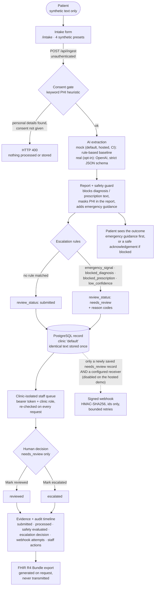
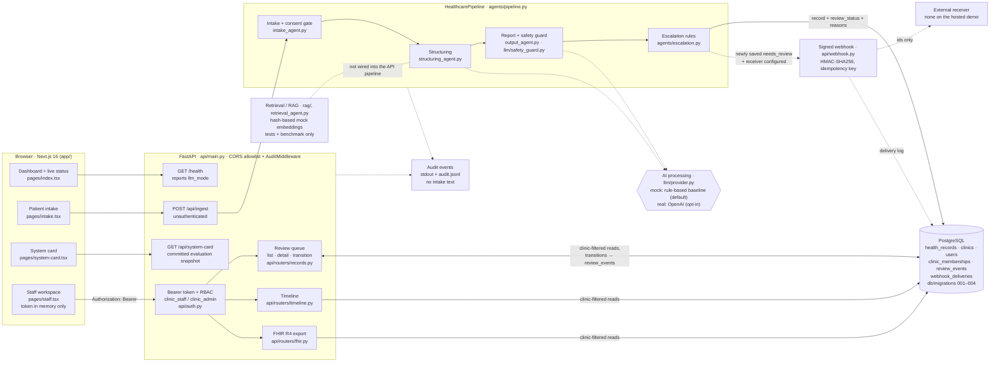

# Architecture Diagrams

Implemented system at the end of Phase 8 (`main` at `dbae578`, Issues #67–#72; diagrams re-checked against the code for #73). Two views:

1. [Patient-to-clinician workflow](#1-patient-to-clinician-workflow): what happens to one intake, from the patient's text to the staff decision and the FHIR export.
2. [System architecture](#2-system-architecture): the components, which file implements each one, and which paths are active at runtime.

In both diagrams, solid arrows are active request paths. Dashed arrows are conditional (they run only when configured) or are code that exists but is not on the API's runtime path. Notes below each diagram say where each claim is checked in the code.

---

## 1. Patient-to-clinician workflow

Notes (each checked against the code):

* **Consent gate.** `agents/intake_agent.py` rejects input that its keyword heuristic flags as personal details when `consent_granted` is false (HTTP 400). Input without such details is processed without consent; the heuristic is not a validated de-identification method.
* **AI extraction.** `llm/provider.py`: `LLM_MODE=mock` is the default and the only mode used by CI and the hosted demo; structuring is the rule-based baseline in `agents/extraction_baseline.py` (#40), not LLM output. `LLM_MODE=real` (`llm/providers/openai_client.py`) is opt-in, refuses to start without a key and never falls back to mock. It has not been run in CI or on the hosted demo.
* **Safety guard and escalation.** `llm/safety_guard.py` and `agents/escalation.py`: deterministic keyword/regex rules. Low confidence means a structuring confidence below 0.5.
* **Storage.** `agents/pipeline.py::save_record` stores every successful run in clinic `default` (`db/models.py::DEFAULT_CLINIC_ID`); there is no per-clinic routing. Byte-identical text hits the `input_hash` unique constraint and returns `duplicate`. Persistence is best-effort and never fails the request.
* **Webhook.** `agents/pipeline.py` calls `api/webhook.py::notify_escalation` only when persistence returned `saved`; the notifier re-reads the record and sends only for `needs_review`, and only when both `WEBHOOK_URL` and `WEBHOOK_SECRET` are set. The hosted demo has no `WEBHOOK_URL` (#67), so delivery is `disabled`. Staff transitions never call the notifier (`api/routers/records.py`).
* **Human decision.** `api/routers/records.py`: only `needs_review` → `reviewed` / `escalated`; each transition is a `review_events` row with the actor.
* **Timeline and audit.** The timeline (`api/routers/timeline.py`) is assembled from the stored record, `webhook_deliveries` and `review_events`. Separately, every request, pipeline run and staff action emits an audit event without intake text (`observability/audit_logger.py`, `api/middleware/audit.py`, `tests/test_audit_no_raw_text.py`).
* **FHIR export.** `interoperability/fhir_export.py` builds a `collection` Bundle on request; it is validated against the pinned R4 JSON Schema in CI (`tests/test_fhir_export.py`). This is not an official HL7 conformance check.

---

## 2. System architecture

Notes (each checked against the code):

* `api/deps.py::get_pipeline()` builds `HealthcarePipeline()` without a `RetrievalAgent`, so `/api/ingest` never runs retrieval (`rag.enabled: false` in the trace). RAG runs only in tests and in `python -m evaluation.benchmark --rag on`.
* Both LLM edges are dashed because the hosted demo and CI run mock mode: no model is called there.
* Staff routes re-read clinic memberships from the database on every request. Another clinic's intake reads as 403 on that clinic's path and 404 on the caller's own path (`tests/test_auth_rbac.py`, `tests/test_review_queue.py`).
* The webhook payload contains only `event`, `schema_version`, `idempotency_key`, `intake_id` and `clinic_id` (`EscalationPayload`, `extra="forbid"`). One logical notification with bounded attempts; no delivery guarantee and no resend.
* `/api/ingest` returns the full pipeline trace, including the raw intake text, to the submitting browser (documented #32 finding, [`../security_data_handling.md`](../security_data_handling.md)).
* The system card serves `evaluation/system_card_results.json`; `tests/test_system_card.py` fails CI if it drifts from the suites.
* Redis in `docker-compose.yml` is unused and not deployed.
* Hosted deployment (`render.yaml`): API and frontend as Docker web services on Render free plans, with a managed PostgreSQL database; migrations and the synthetic demo seed run on API start (`scripts/start_api.sh`). See [`../deployment.md`](../deployment.md).
