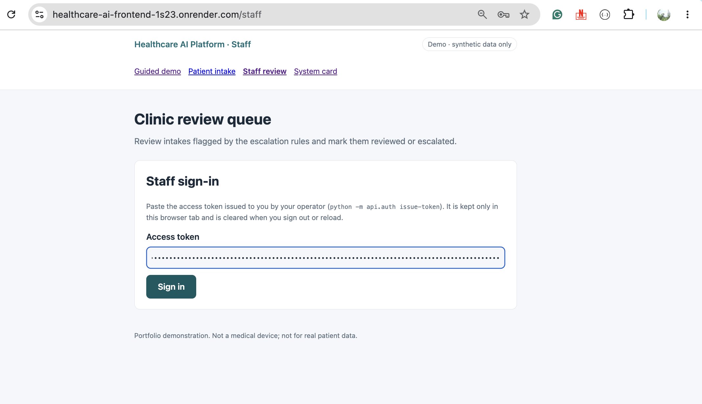
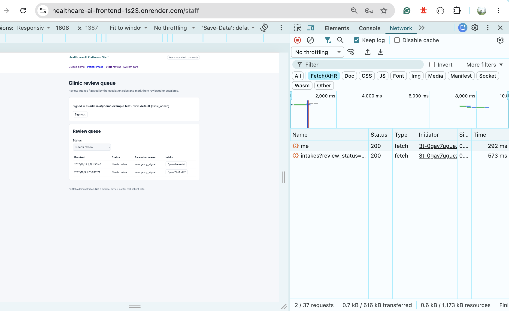
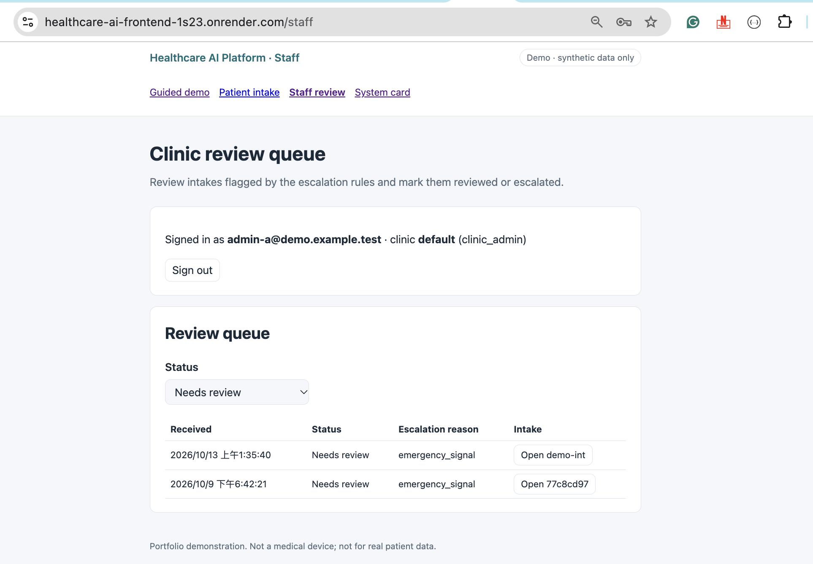
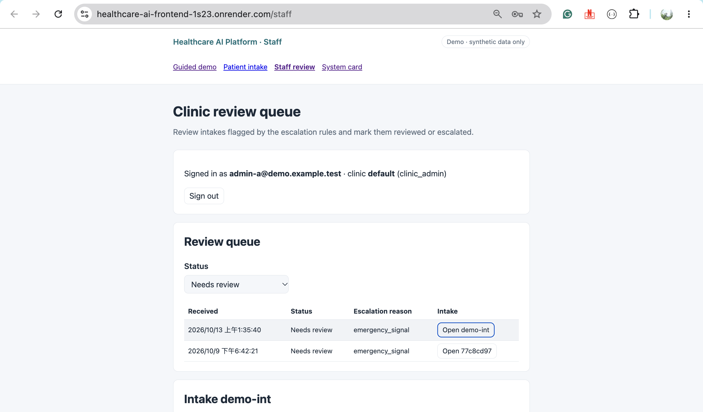
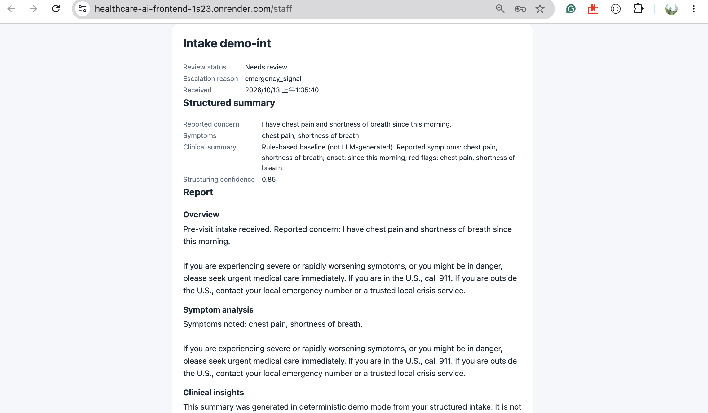
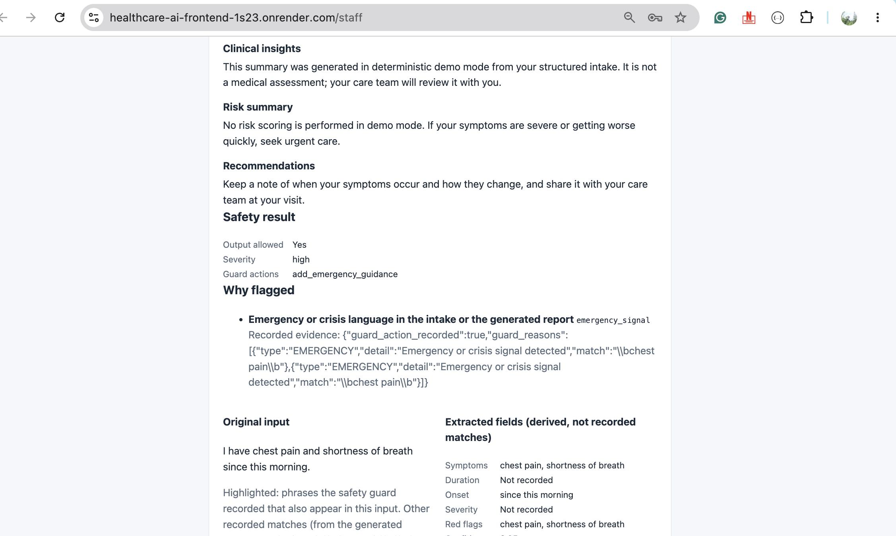
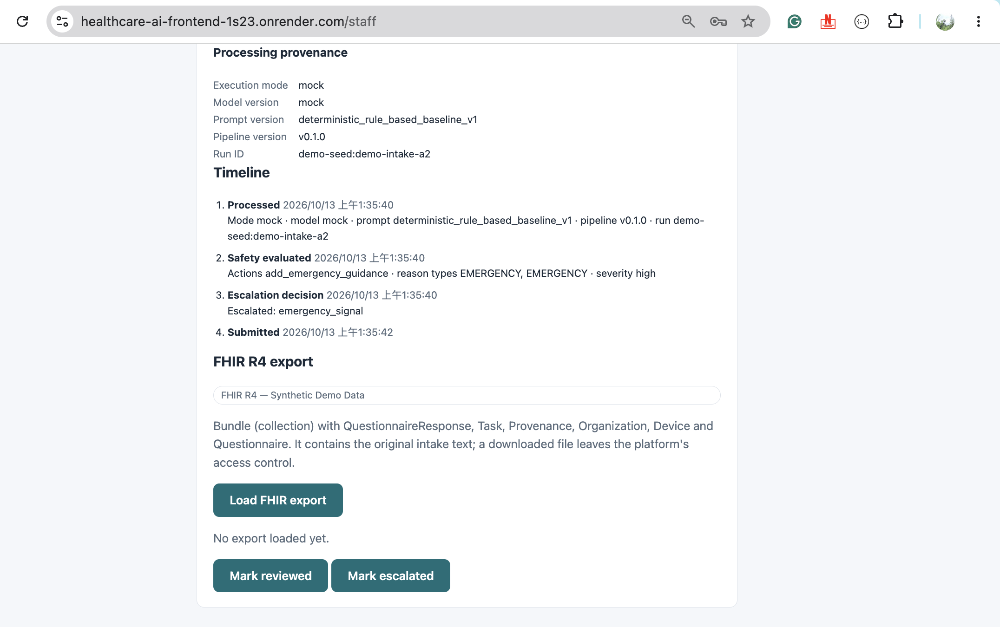
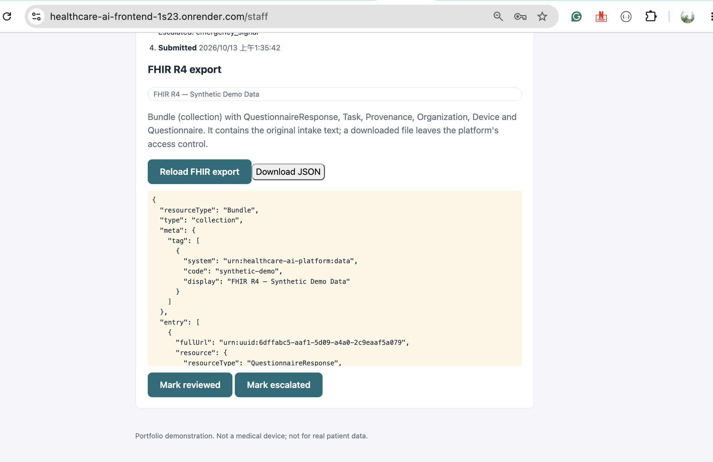
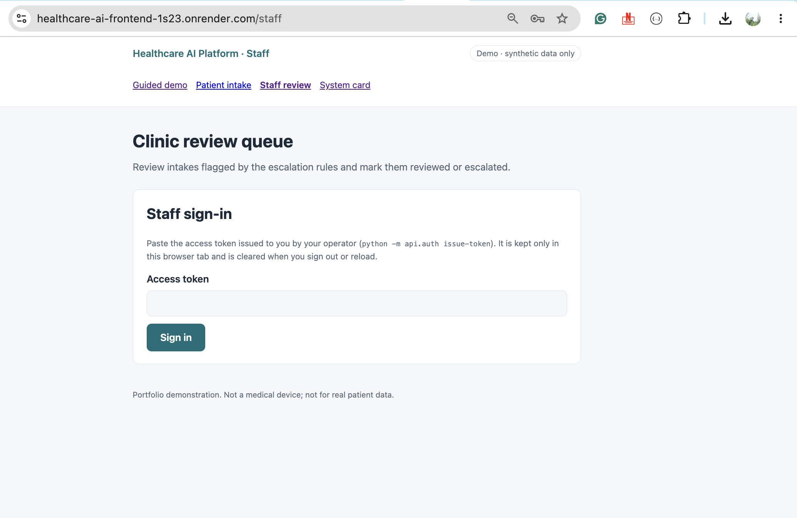

# Phase 7 — Demo Experience, AI Evidence & FHIR Interoperability

Healthcare AI Platform
Timeline: Phase 7 (2026-10-12 – 2026-10-13)
Scope: Issues #40, #41, #42, #43
Status: Completed (2026-10-13) — #40–#43 closed (2026-10-12); PRs #60–#64 merged. Hosted API redeployed from `2afdb4b` and verified on 2026-10-13 (read-only staff checks; flagged scenarios not re-submitted, §4). Staff browser UI verified on the hosted demo on 2026-10-14 (§4a).

---

## 1. Phase Goal

Turn the hosted demo into a self-explanatory walkthrough and back it with visible evidence ([`step3_roadmap.md`](../step3_roadmap.md) §2, §7):

* An honest, measured extraction baseline in mock mode (#40)
* Per-intake evidence and an auditable review timeline for staff (#41)
* An export-only, validated FHIR R4 representation of an intake (#42)
* A guided demo, a system card and the Phase 7 close-out (#43)

Out of scope throughout: real LLM mode on the hosted demo, real patient data, compliance claims, a FHIR server or EHR connectivity, clinical coding, analytics dashboards.

---

## 2. Pull Requests

| PR | Issue | Head commits | Merge commit | Main CI run |
| --- | --- | --- | --- | --- |
| #60 Deterministic extraction baseline & extraction evaluation | #40 | `cfac44b` | `ba2aa3f` | 38234168161 — success |
| #61 Intake evidence & review timeline | #41 | `63001bd`, `efd4a17` | `428fbf9` | 38235577805 — success |
| #62 FHIR R4 export of reviewed intakes | #42 | `8c962a4`, `47d4023` | `b91d6ea` | 38237316553 — success |
| #63 Guided demo, system card & Phase 7 close-out | #43 | `8946ec4`, `5fd759b` | `2afdb4b` | 38238842122 — success |
| #64 Phase 7 merge state & hosted deployment (docs) | — (follow-up to #63) | `02ec30e`, `98d2a1d` | `4194d18` | 38288257899 — success |

#60–#63 were merged with merge commits after a final review gate; #64 is documentation only (merge state and the hosted evidence in §4). Two gates were blocked and fixed on the branch before merge: #61 (naive intake timestamps displayed in the browser's local time → normalised to UTC, sorted on parsed datetimes) and #62 (Questionnaire consent wording did not match the intake form → exact wording plus a regression test).

---

## 3. Completed Issues

### Issue 40 — Deterministic Extraction Baseline & Extraction Evaluation

**Delivered:** `agents/extraction_baseline.py` (documented synthetic lexicon, negation window, duration/onset/severity/red flags), coverage-based confidence `0.1 + 0.4·[≥1 symptom] + 0.15·[≥2] + 0.2·[duration|onset] + 0.15·[severity]` (no symptom ⇒ ≤ 0.45 < 0.5 ⇒ `low_confidence`), template summary labelled "not LLM-generated", `--suite extraction` with per-run and aggregate precision/recall (mock in CI, real opt-in).
**Evidence:** extraction 6 cases, micro/macro P = R = 1.00 (**in-sample**: the lexicon was written with these cases in view). #32 re-run: 16/16 guard and escalation matches; four cases gained `low_confidence`; `em_paraphrased_breathing` caught in mock mode (known gaps 4 → 3).
**Limitations:** fixed English lexicon, crude negation, one duration/onset per intake.

### Issue 41 — Intake Evidence & Review Timeline

**Delivered:** `GET /api/clinics/{clinic_id}/intakes/{id}/timeline` (`api/routers/timeline.py`), migration `004_review_events.sql` (transition history written in the same transaction as the status change), "Why flagged" evidence panel and timeline in the staff detail view (`app/components/IntakeEvidence.tsx`).
**Evidence:** 9 backend timeline tests (three triggers, ordering, persisted webhook/transition accuracy, legacy nulls, UTC normalisation, cross-clinic denial, ids-only audit); #34 audit test extended.
**Limitations:** stage times are not persisted (processing/safety/escalation carry the record time); emergency matches from the intake-text check were never stored; the shown threshold is the current constant; pre-#41 transitions are not backfilled.

### Issue 42 — FHIR R4 Export of Reviewed Intakes

**Delivered:** `GET /api/clinics/{clinic_id}/intakes/{id}/fhir` (`api/routers/fhir.py`, `interoperability/fhir_export.py`), deterministic Bundle (`QuestionnaireResponse`, `Questionnaire`, `Task`, `Organization`, `Device`, `Provenance`), JSON preview/download labelled "FHIR R4 — Synthetic Demo Data".
**Evidence:** official HL7 FHIR R4 4.0.1 JSON Schema vendored and SHA-256 pinned, plus required-primitive and reference checks; committed synthetic example must equal exporter output; isolation and ids-only audit tests.
**Limitations:** not the full HL7 validator (no profiles/invariants/terminology); reviewer is a staff user id only; `reviewed`/`escalated` both map to `Task.status = completed` (kept in `businessStatus`); downloaded files leave platform control.

### Issue 43 — Guided Demo, System Card & Phase 7 Close-out

**Delivered:** landing page with Patient / Staff / System card entry points and the workflow (`app/pages/index.tsx`, intake moved to `/intake`); four scenario presets that fill text only (`app/services/demo.ts`); developer trace behind a reviewer toggle; seeded synthetic intakes in two clinics covering every status, refused unless `APP_ENV=demo` (`db/seed_demo.py`); read-only `GET /api/system-card` and `/system-card` page serving the committed snapshot `evaluation/system_card_results.json`; demo staff identities (never tokens) shown only when `NEXT_PUBLIC_DEMO_MODE=true`.
**Evidence:** the snapshot is re-computed and compared in CI (`tests/test_system_card.py`); preset outcomes pinned through the real pipeline; seed idempotency, status coverage and clinic isolation tests; frontend tests for presets, toggle, system card and demo-flag visibility.
**Limitations:** the 2026-10-13 hosted verification (§4) is API-level plus public pages; the staff browser UI was verified on the hosted demo on 2026-10-14 (§4a); the three flagged presets were not exercised on the hosted demo; tokens still require the operator (no self-service sign-in, by design); seeded transitions are synthetic demo history.

---

## 4. Validation Summary

* Every Phase 7 PR passed the three CI jobs (backend + PostgreSQL, deterministic benchmark incl. extraction and safety suites, frontend lint/typecheck/test/build) on its final head and on `main` after merge (runs in §2).
* Post-merge `main` CI at `4194d18` (PR #64, run 38288257899): backend **248 passed** with 11 PostgreSQL integration tests executed; frontend 63 tests passed; deterministic benchmark green, extraction suite micro/macro P = R = 1.00 (in-sample, §3).
* Hosted verification, 2026-10-13. Synthetic data only; staff checks were read-only and used 1-hour operator-issued tokens for the three seeded users.
  * **Deploy.** Render *Manual Deploy* of `main` at `2afdb4b` (replacing the Phase 6 build `3e984e3`; `main` CI run 38238842122 — success). Start log: `Applied migration 004_review_events.sql`, `Migrations complete (1 applied)`, `Demo seed complete (12 rows created)` (8 intakes + 4 seeded transitions), `Application startup complete`. The previous instance served `/health` until the new one was live.
  * **API.** `/health` → `environment: demo`, `llm_mode: mock`. `/openapi.json` lists `/api/system-card`, `…/timeline` and `…/fhir`. The `evaluation` block of `GET /api/system-card` is identical to `evaluation/system_card_results.json` (#32: 16 cases, guard and escalation match 1.00, 3 known gaps; #40: 6 cases, micro/macro P/R 1.00). Without a token every staff route returns 401.
  * **Frontend.** `/`, `/intake`, `/staff` and `/system-card` return 200. The landing page lists the workflow and the three demo identities (no tokens). `/intake` shows the four preset buttons. `/system-card` renders the API's numbers above.
  * **Intake.** The routine preset submitted to `POST /api/ingest`: `submitted`, no reasons, symptoms `sore throat`, `fever`, duration `two days`. One record stored (an identical second submission was not stored again). The emergency, prescription and vague presets were **not** submitted to the hosted demo, because a flagged intake sends a real webhook. Their outcomes (`emergency_signal`, `blocked_prescription`, `low_confidence`) are verified by CI and a local mock-mode run of the same commit only.
  * **Queues and isolation.** `/api/staff/me` returns the expected single membership for each user. Clinic `default` (as `demo-staff-a` and `demo-admin-a`) shows `demo-intake-a1…a4` as `submitted`, `needs_review`, `reviewed`, `escalated`, plus two live intakes (the routine one above and the Phase 6 acceptance intake of 2026-10-09). `demo-clinic-b` (as `demo-admin-b`) shows `demo-intake-b1…b4` as `submitted`, `needs_review`, `escalated`, `reviewed`. Neither queue contains the other clinic's intakes. Cross-clinic list, detail, timeline, FHIR and member reads return **403** in both directions. Another clinic's intake id under one's own clinic path returns **404**. `clinic_staff` cannot change memberships (`PUT …/members/…` → 403, sent with the member's unchanged role). Tampered and malformed tokens → 401.
  * **Timeline.** All eight seeded intakes: status and clinic match, escalation reasons match the seed, and the four seeded transitions show the right actor and `needs_review` → `reviewed`/`escalated`. The Phase 6 intake shows its persisted `webhook_delivery` (delivered, 1 attempt, HTTP 200, 2026-10-09). No new delivery was created in this session.
  * **FHIR.** All ten intakes in both queues return `application/fhir+json` collection Bundles (6 entries; 7 with a seeded transition) that pass `interoperability.fhir_validation.validate_bundle` (R4 JSON schema per resource, required fields, internal references resolve).
  * **Audit.** The Render logs show one `intake.fhir_export` event per export with `actor_id`, `action`, `clinic_id` and `resource_id` only, no intake text. Denied (403) requests appear only in the request log; no audit event is written for a denial.
  * **Observed limitation.** In the seeded intakes' timelines, `submitted` is listed after processing and the seeded transition. PostgreSQL `NOW()` gives every row created in the one seed transaction the same `created_at`, which is earlier than the intake timestamps. Live intakes (one transaction each) list `submitted` first.
  * **Not verified on the hosted demo (2026-10-13):** the staff browser UI (token entry, queue, evidence and FHIR preview/download in the page), the three flagged presets, and a new signed webhook delivery. The 2026-10-09 Phase 6 acceptance remains the hosted webhook evidence. The staff browser UI was verified on 2026-10-14 (§4a).

### 4a. Hosted Staff Browser UI Verification (2026-10-14)

Manual run of the staff review UI at `https://healthcare-ai-frontend-1s23.onrender.com/staff` against the hosted API deployed from `2afdb4b` (§4). No application code, configuration or deployment changed. Synthetic data only; mock mode. Signed in as `demo-admin-a` (`admin-a@demo.example.test`, `clinic_admin` of clinic `default`, "Clinic A") with an operator-issued token; the token is masked in every screenshot and is not recorded here. No intake was submitted and no webhook was sent: the only write was a staff status transition, and the webhook fires only when ingest stores a new `needs_review` intake ([`escalation_webhook.md`](../escalation_webhook.md#trigger)).

| Check | Result | Evidence |
| --- | --- | --- |
| Staff token authentication | PASS | Screenshots 1–2: masked token entered; "Signed in as admin-a@demo.example.test · clinic default (clinic_admin)"; Network tab shows `me` and `intakes?review_status=…` → 200 |
| Clinic A review queue | PASS | Screenshots 3–4: "Needs review" filter lists `demo-intake-a2` (seeded, `emergency_signal`) and `77c8cd97…` (Phase 6 acceptance intake of 2026-10-09); no `demo-clinic-b` intake |
| Intake details and structured report | PASS | Screenshot 5: review status, escalation reason, received time, structured summary (confidence 0.85, "Rule-based baseline (not LLM-generated)") and report sections with emergency guidance |
| Safety evidence and processing provenance | PASS | Screenshots 6–7: safety result (severity high, `add_emergency_guidance`), "Why flagged" `emergency_signal` with recorded guard evidence, extracted fields; provenance mode/model `mock`, prompt `deterministic_rule_based_baseline_v1`, pipeline `v0.1.0`, run `demo-seed:demo-intake-a2` |
| Review timeline | PASS | Screenshot 7: Processed → Safety evaluated → Escalation decision (`emergency_signal`) → Submitted |
| FHIR R4 export preview | PASS | Screenshot 8: "FHIR R4 — Synthetic Demo Data" label; Bundle preview after "Load FHIR export" |
| FHIR JSON download | PASS | "Download JSON" saved the file below (valid JSON, identical to the downloaded original) |
| Mark reviewed status transition | PASS | Operator-observed: `demo-intake-a2` moved from `needs_review` to `reviewed`. No screenshot of the post-transition state was captured |
| Staff sign-out | PASS | Screenshot 9: sign-in form shown again with an empty access-token field |

**Screenshots** (copied unchanged from the session; times are the browser's local zone, UTC+8):

1. Staff sign-in with the token entered (masked)

   
2. Signed in; Network tab shows the `me` and queue requests returning 200

   
3. Clinic A review queue filtered to "Needs review"

   
4. Opening `demo-intake-a2` from the queue

   
5. Intake detail: structured summary and report

   
6. Safety result, "Why flagged" evidence and extracted fields

   
7. Processing provenance, review timeline and the FHIR export panel before loading

   
8. FHIR R4 export preview with "Download JSON"

   
9. After sign-out

   

**Downloaded artifact:** [`intake-demo-intake-a2-fhir-r4.json`](evidence/phase7_hosted_browser_2026-10-14/intake-demo-intake-a2-fhir-r4.json), a `collection` Bundle tagged `synthetic-demo` with six entries: `QuestionnaireResponse` (identifier `demo-intake-a2`, the synthetic intake text and consent `true`), `Questionnaire` (the static pre-visit intake form), `Task` (`status: ready`, `businessStatus: needs_review`, reason `emergency_signal`; exported before the transition), `Organization` (clinic `default`), `Device` (model `mock`, prompt `deterministic_rule_based_baseline_v1`, pipeline `v0.1.0`) and `Provenance` (targets the QuestionnaireResponse and Task, agent the Device). It contains no token, real person or contact data. Locally it parses as JSON and `interoperability.fhir_validation.validate_bundle` returns no errors (R4 JSON Schema per resource, required fields, internal references). It was not run through the official HL7 validator.

**Limits of this evidence:** one seeded intake in one clinic, one browser session, no automated browser E2E test; "Mark escalated" and the cross-clinic view were not exercised in the browser (cross-clinic denial is verified at API level, §4); the emergency, prescription and vague presets remain unverified on the hosted demo because the webhook destination has not been isolated. This is not full hosted E2E coverage and not a FHIR conformance claim.

---

## 5. Known and Carried-forward Limitations

* Rule-based safety, escalation and extraction: paraphrases and out-of-lexicon text are missed; evaluation sets are tiny, synthetic and partly in-sample.
* Raw intake text is stored unmasked and returned to authorized staff (timeline, FHIR export).
* No real-mode measurements; the hosted demo stays in mock mode.
* Hosted demo gaps (§4, §4a): the emergency, prescription and vague presets were not exercised on the hosted demo, because the webhook destination has not been isolated and each flagged submission sends a real webhook; the staff browser UI was verified on 2026-10-14 for one seeded intake in clinic `default` only; the last hosted signed-webhook evidence is the Phase 6 acceptance of 2026-10-09. Render free tier limits are unchanged ([`deployment.md`](../deployment.md) §5).
* FHIR export is checked against the R4 JSON Schema plus local required-element and reference checks only, not the official HL7 validator, profiles or terminology. Exports carry raw intake text ([`security_data_handling.md`](../security_data_handling.md)).

---

## 6. Closure

Phase 7 completed on 2026-10-13: #40–#43 are closed, PRs #60–#64 are merged and post-merge `main` CI is green (§4). Phases 1–7 are complete. Synthetic data only; mock mode only on the hosted demo; no HIPAA compliance, FHIR conformance or production-readiness claim.
